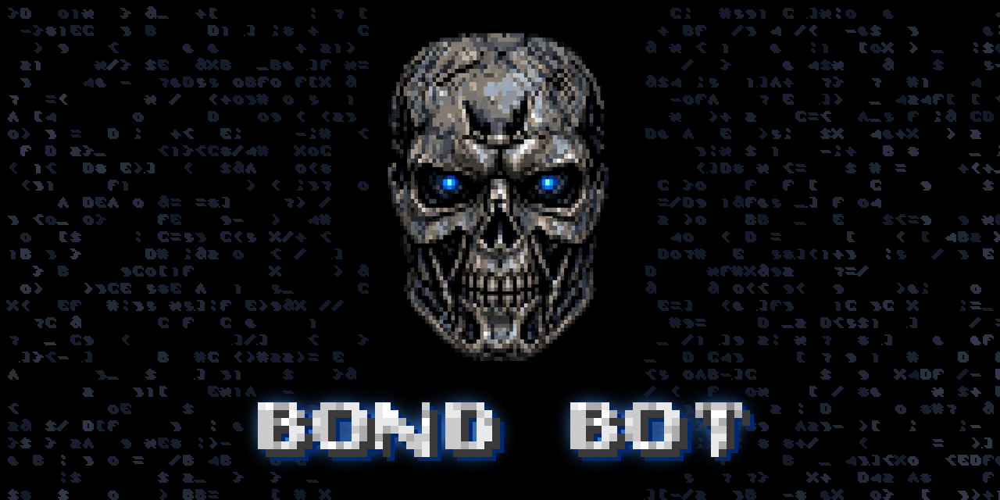

BondBot is a self-hosted crew of AI teammates. Each one has its own memory, routines, apps and
computer. It runs on your own machine, with your own model keys.

## Features

- **A computer for every bot.** Browser, terminal, files and a full desktop. Watch it work, take
  control to sign in, then hand it back.
- **Bots that work together.** Put them in a group, @mention them, and they split the work.
- **Routines.** Run a bot on a schedule, from an email or from a webhook.
- **Voice notes and calls.** Record offline; it sends and transcribes when you are back.
- **VPN per bot,** with a kill switch. Upload your VPN's WireGuard files in Settings and test
  them in one click ([setup](./docs/bondbot/VPN.md)).
- **Live reasoning** under each reply, and one-tap model switching.
- **Phone friendly.** Split view with the bot's screen docked above the chat.
- **The look.** A pixel skull that builds itself out of code, a Quake-font wordmark, pixel cursor
  effects, and dark blue and dark purple themes.
- **PIN sign-in.** Pick a 6-digit PIN instead of a password, with dial-up tones.

## Run from source

You need Node.js 24.15+ (24.x) or 26+, pnpm 12 and Docker.

```bash
pnpm install
```

```bash
cp .env.example .env
```

```bash
pnpm sandbox:build
```

```bash
pnpm dev
```

Server images build from [infra/compose/Dockerfile](./infra/compose/Dockerfile).

A 6-digit PIN is much weaker than a password. Keep a server that allows it on a private network.

## Docs

- [What changed](./docs/bondbot/CHANGELOG-BONDBOT.md)
- [Deploy notes and gotchas](./docs/bondbot/LOCAL-PATCHES.md)
- [Guides](./docs)

## License

Apache-2.0. See [LICENSE](./LICENSE) and [NOTICE](./NOTICE).
